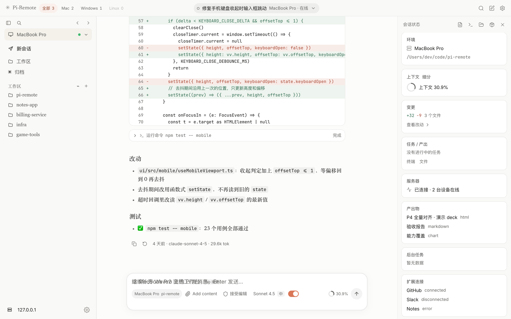
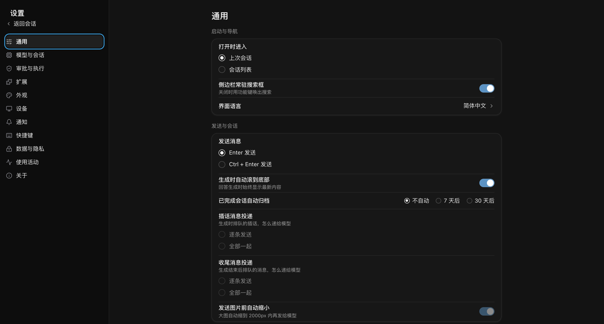
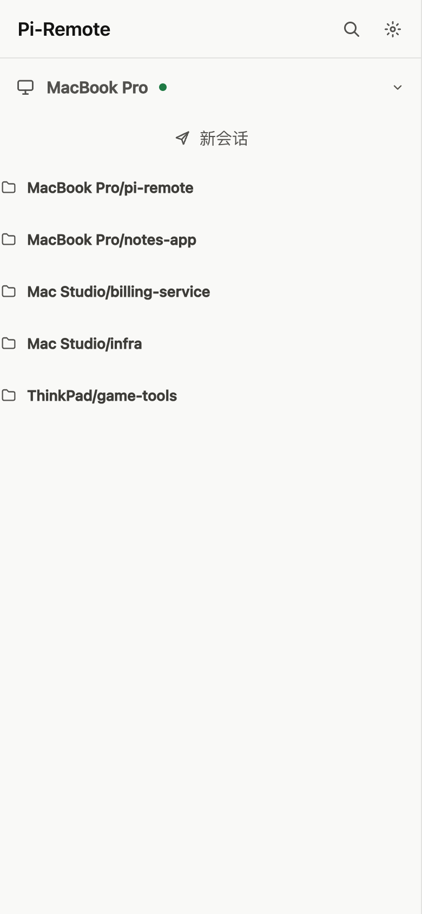

English | [简体中文](README.zh-CN.md)

# pi-remote — multi-device sync for the pi terminal
[](https://github.com/Xpropel/pi-remote/stargazers)
[](LICENSE)
[](package.json)
[](https://github.com/Xpropel/pi-remote/commits/main)


Without changing pi's source code or hijacking the terminal: using pi's official **extension API** (`pi.on()` events + `pi.sendUserMessage()` injection),
it **mirrors in real time** the pi session running in your local terminal to a phone/another computer's browser. From the remote side you can send messages and commands to the same session —
the remote experience is equivalent to the terminal (model switching, thinking level, compaction, session tree, queue, usage and cost — nothing is missed).


<p align="center">
  
</p>
<p align="center"><sub>Demo data from the built-in development gallery — no real sessions or credentials.</sub></p>

## At a glance

- **Your terminal stays yours** — pi runs unchanged on your machine; Pi-Remote attaches through its official extension API.
- **One session, every screen** — mirror the live session to a phone or another browser, and send messages or commands back into the same session.
- **No separate agent runtime** — the relay only routes JSON frames; model credentials and source code stay on your device.
- **Unified UI, six skins** — Cursor / Claude / Codex looks in dark and light, with a shared settings system and a mobile-first shell.

```
Local machine (Windows)                                          Cloud server (<your-server-ip>)
┌────────────────────────────────────────────┐                   ┌──────────────────────────────────────────────────────────┐
│ pi CLI (official, D:\pi\pi.exe)            │                   │ systemd: pi-remote.service                               │
│  └ extension/ (sync extension)             │ ══ 7001 local ══▶ │  relay/server.js + relay/store.js                        │
│    pi-remote-sync.ts                       │  (extension only) │   · 7001 accepts local extensions only                   │
│    → ~/.pi/agent/extensions/               │                   │   · 7002 serves the UI (page + WS)                       │
│ .env (relay URL / token / display name)    │ ◀═ 7002 viewer ══ │   · statically hosts web/ (frontend build)               │
│ deploy\start-pi.cmd starts pi              │    (page + WS)    │   · data/accounts/ account/device/session index          │
│ deploy\attach.cmd opens the window         │                   │   · data/rooms/ writes bodies only with persistence on   │
└────────────────────────────────────────────┘                   └──────────────────────────────────────────────────────────┘
        Zero change to the local terminal experience                                 ▲ Open http://<your-server-ip>:7002/ in a phone/other computer browser
                                                                        (token <your-viewer-token>; the "mirror window" of the same session)
```

## 1. System components (four categories by deployment location)

> The local side supports **Windows / macOS / Linux**, and multiple devices can connect to the same relay at the same time (one device ID per machine; the web roster shows each platform).
> The table below uses Windows as an example; the corresponding macOS / Linux scripts are in [§4 Quick start](#4-quick-start) and section 4 of [deploy/README.md](deploy/README.md).

### A. Local machine (your Windows / Mac computer) — outbound only

| Component | Location | Responsibility |
|---|---|---|
| pi CLI | `D:\pi\pi.exe` (official) | The terminal itself that runs models/tools, **zero changes** |
| Sync extension | `extension/pi-remote-sync.ts` → synced to `%USERPROFILE%\.pi\agent\extensions\` | Runs inside the pi process: forwards 38 session events (payload projection + delta merge + large-image placeholder), mirrors with hash-based incremental alignment, receives remote message injection (idle → send directly / busy → steer, with delivery confirmation), provides **45 remote commands** (24 aligned with pi's official RPC + 21 extension-specific; including real session operations such as set_model/compact/new_session/fork/clone/navigate_tree), and reconnects with backoff on disconnect. **attach window gating**: it connects to the cloud only while `pi-remote attach` is running (the local state file exists); device identity (accountId/deviceId) comes from `.env`, and `session_manifest` reports **indexes only** (session id/name/entry count/size/time), never message bodies. Logs go to `~/.pi/agent/pi-remote-sync.log` |
| Local configuration | `.env` (template `.env.example`) | `PI_REMOTE_RELAY` URL, `PI_REMOTE_TOKEN`, room display name; `PI_REMOTE_ACCOUNT/DEVICE_ID/DEVICE_NAME/PROJECTS` for device identity and project allowlist; `deploy\\start-pi.cmd` reads them and injects them into pi |
| Local relay (for integration testing) | `npm run relay` → runs a local copy of `relay/server.js` + `relay/store.js` | Lets you run closed-loop integration testing without the cloud server; in production it runs in the cloud |
| Local relay data | `data/rooms/*.jsonl` | Session storage during local integration testing (runtime artifact; not written by default, written only when `PI_REMOTE_PERSIST_TRANSCRIPTS=1` is set, with automatic cleanup after 30 days) |

### B. Cloud server (`<your-server-ip>` · Ubuntu 24.04) — pure relay + storage

| Component | Location | Responsibility |
|---|---|---|
| relay service | `/opt/pi-remote/app/relay/{server,store,index}.js`, systemd `pi-remote.service` | 7001 local channel (auth / attach window registration / device roster / room registration / events / snapshot alignment / injection) + 7002 viewer channel (room list / subscription / incremental resubscription / command acceptance and dedupe / interrupt) + rate limiting + backpressure + heartbeat; **does not ship pi and never touches model credentials**. Tokens live in `/etc/pi-remote.env` (600, root only) |
| Account/device/session index | `/opt/pi-remote/app/data/accounts/` (managed by `relay/index.js`) | Append-only jsonl indexes: `accounts/index.jsonl` + `<account>/devices.jsonl` + `<account>/sessions/<device>.jsonl` (upsert / tombstone / monotonic updatedAt). **Indexes only, no message bodies** (session bodies are not persisted by default; enabled only with `PI_REMOTE_PERSIST_TRANSCRIPTS=1`), and `get_sessions` can be read even while disconnected |
| Frontend build | `/opt/pi-remote/app/web/` (uploaded by `deploy-web.ps1`, includes the smoke-test page `verify.html`) | relay serves it statically on the **same 7002 port** (no separate nginx) |
| Session storage | `/opt/pi-remote/app/data/rooms/<roomId>.jsonl` (off by default) | When persistence is enabled: append messages to disk (each with a seq, first line records rev) + 500-entry in-memory hot cache per room + full assembly (safety valve at 10,000 entries / 24MB) + incremental resubscription after disconnect + recovery after restart + 30-day cleanup |

### C. UI / frontend (`ui/` source → `web/` build)

| Directory | Contents |
|---|---|
| `ui/src/relay/` | WS client `useRelay.ts` (auth / subscription / since resubscription / usage_state / attach window roster) + `sync.ts` (alignment rules for snapshots and sequenced events) + `commands.ts` (command channel: acceptance receipts, timeouts, dedupeKey retries) + `devices.ts` (device roster parsing, error-code messages, enable/create state machine, room selection rules) + `transcript.ts` (reducer from snapshot + events → render items; streaming typewriter, tool cards, and dedupe all live here) |
| `ui/src/pi/` | UI: entry points `main.tsx` / `PiApp.tsx` (desktop layout at width ≥ 1024, otherwise mobile layout), `containers/` (wire up useRelay and pass data to components), `model/` (pure functions, tested directly with node --test), `hooks/`, `styles/` (tokens), `dev/` (development gallery, excluded from the production bundle) |
| `ui/src/components/pi/` | Pi components: `shared/` (root node, shell, sidebar, top bar, overlays, pi-theme.css), `shell/` (login, pairing, session menu, search), `conversation/` (conversation stream, approval cards, terminal / changes / files panes, lightbox), `composer/` (input area, menus, command palette, dialogs, settings page) |
| `ui/src/components/kit/` | Base components ported from the Cursor 3 Agents Window (read-only `--cw-*` tokens) |
| `web/` | Build output of `ui` (**do not edit by hand**; generated and deployed by `deploy-web.ps1`) |

See [ui/README.md](ui/README.md) for entry points, directories, tokens, the development gallery, and the development gallery.

### D. Shared: contracts and docs (`readyUI/` contracts + `DOC/` technical designs) — not part of the deployment path

| File | Purpose |
|---|---|
| `readyUI/data-interface.md` (**v3.1, single source of truth**) | Transport layer, 12 downstream envelopes, delta sync (rev/seq/since), command acceptance and dedupe, 38 pi events + 2 extension-level events and their payload projection, 45 remote commands, message/toolResult data structures, streaming reconstruction algorithm, TS types |
| `readyUI/pi-interface-inventory.md` | Interface inventory ledger (event matrix / 33-command audit / unexposed opportunities / roadmap / progress) |
| `DOC/10-relay-backend.md` | Backend design: the index.js index module, the seven applyManifest rules, frame handling, command routing/allowlist |
| `DOC/20-local-device.md` | Local device design: attach command lifecycle, `.env` device identity, extension change points, Windows spawn rules |
| `DOC/30-server-ops.md` | Operations design: systemd + token env file, deployment, migration, backup, token rotation, rollback |
| `DOC/50-protocol-delta.md` | Shared protocol delta: 10 new frames, 7 error codes, parameter tables, old/new compatibility matrix |
| `DOC/device-harness.md` / `DOC/session-registry.md` | Conceptual sources: the attach window model / the server-stores-indexes-only model |

## 2. Directory structure

```
D:\pi-myself\
├─ extension/pi-remote-sync.ts   # local: extension inside the pi process (the only code that must be installed into pi)
├─ relay/server.js               # backend: dual-port relay + attach windows/device roster/command routing
├─ relay/store.js                # backend: session storage (rev/seq/since deltas; message bodies not persisted by default)
├─ relay/index.js                # backend: account/device/session jsonl indexes (indexes only)
├─ ui/                           # frontend source (React 19 + TS + Vite 8 + Tailwind 4); see ui/README.md
│  └─ src/{pi,components/{pi,kit,ui},relay,chat,shell,mobile,conversation,lib}
├─ web/                          # frontend build (deployed to the server, served by relay on the same 7002 port)
├─ readyUI/                      # contracts and review docs (the frontend team develops against data-interface.md)
├─ DOC/                          # technical design and protocol deltas (10 backend / 20 local device / 30 ops / 50 protocol / 71 protocol v4 / 76 settings write bridge / device-harness / session-registry)
├─ test/                         # npm test (2,000+ cases): store / relay protocol / frontend sync and command channel / extension pure functions / attach windows / device roster / launch and deployment scripts / new UI components and pure functions (test/pi-*.test.mjs) / source structure checks (pi-structure)
├─ deploy/                       # deployment/ops: see deploy/README.md
│  ├─ sync-extension.ps1         #   extension → ~/.pi/agent/extensions/ (MD5 verification)
│  ├─ deploy-relay.ps1           #   relay → cloud server (MD5 verification + restart + loopback check)
│  ├─ deploy-web.ps1             #   ui build → web/ → cloud server (verify / returns 200)
│  ├─ attach.cjs / attach.cmd    #   local attach window: pi-remote attach [dirs...] [--max-hours 12] (cross-platform; the Windows shell is .cmd)
│  ├─ attach.sh                  #   macOS / Linux shell
│  ├─ setup.cjs                  #   generate .env (auto-fill token)
│  ├─ start-pi.cmd / start-pi.sh #   start pi with environment variables (Windows / macOS, Linux)
│  ├─ sync-extension.sh          #   macOS / Linux extension sync
│  ├─ deploy-relay.sh / deploy-web.sh  # macOS / Linux deployment (the scripts executed on the server are character-for-character identical to the .ps1 versions; tests guard this)
│  ├─ pi-remote.service          #   systemd unit (token from /etc/pi-remote.env, 600)
│  └─ verify.html                #   deployment smoke-test page
├─ data/rooms/                   # runtime: session storage for the local relay (gitignore)
├─ data/accounts/                # runtime: account/device/session indexes (gitignore)
├─ backup/                       # local archive (gitignore, not in the public repo): old UI references, old copies superseded by relay/, merged drafts
├─ .pi/plan/                     # local: initial task planning
├─ logs/                         # runtime: logs (gitignore)
├─ .env / .env.example           # local configuration (.env is gitignored; .env.example is the template)
└─ package.json                  # npm run relay (start local integration testing) / npm test
```

## 3. How a single piece of data travels

| Scenario | Path |
|---|---|
| Model output in the terminal | pi → extension `pi.on("message_update")` (same-type deltas within 25ms merged into one frame) → 7001 → relay broadcasts to 7002; `message_end` is persisted with a seq → UI `transcript` reducer renders it with a typewriter effect |
| Footer usage/cost | The extension computes it on message_end/compaction_end/settle → `usage_state` frame → UI status bar (**zero polling**) |
| Sending a message remotely | UI → `prompt` (idle) / `steer` (busy) command → 7002 → 7001 → extension `sendUserMessage(deliverAs)` → pi handles it as a normal user message; meanwhile `remote_message` is pushed back to all clients, and `remote_message_failed` is pushed if pi did not accept it |
| Sending a command remotely | UI → `command` frame (with dedupeKey) → relay replies with `command_accepted` (authoritative timeout) → the extension executes it in-process (set_model / compact / new_session / get_projection...) → `ack` is returned by id; retransmissions after packet loss are deduped by relay, so a command is never executed twice |
| Phone just opened the page | auth → subscribe → relay assembles a **complete snapshot** from the store (no pagination) + the current usage_state + the live event stream from then on → identical to everything seen in the terminal |
| Disconnect / relay restart | After reconnecting, the extension uses head/tail hashes to fetch only the messages from the downtime; page reconnects pass `since:{rev,seq}` and receive only incremental snapshots |
| "Opening a session" on the phone | UI sends `harness_start{cwd or sessionId}` → relay validates the device allowlist/index → commands the attach window to spawn `start-pi.cmd` → the new room appears in `room_list` → the frontend subscribes automatically (not browsing history, but actually starting a session) |
| Device online/offline | attach window connects/disconnects → `device_register` updates the in-memory online bit + a full `session_manifest` → the frontend roster and the "N ended" collapsible section update in real time |


## Screenshots

<table>
<tr>
<td width="50%"><br><sub>Conversation, tool output, and the status rail</sub></td>
<td width="50%"><br><sub>Unified settings — 11 pages × six skins</sub></td>
</tr>
<tr>
<td width="50%"><br><sub>Mobile session list (list / drawer modes)</sub></td>
<td width="50%"><em>More screenshots are generated from the development gallery; the gallery contains demo fixtures only.</em></td>
</tr>
</table>

## 4. Quick start

**Closed-loop local integration testing** (no cloud involved):

```powershell
cd D:\pi-myself
npm install
npm run relay                    # 127.0.0.1:7001 + 7002
deploy\start-pi.cmd              # another terminal: start pi with the environment variables (.env can temporarily point to 127.0.0.1)
# browser http://127.0.0.1:7002, token <your-viewer-token>
```

**Production use** (once the cloud server is deployed): on the local machine run `deploy\\attach.cmd` (the attach window; only then does the device come online) → `deploy\\start-pi.cmd` to start pi → open `http://<your-server-ip>:7002/` in a phone/computer browser and enter the token. Closing the window (Ctrl+C / expiry) = the device goes offline immediately, and the extension has zero connections.

**macOS / Linux** (same repository, but use the `.sh` scripts; requires Node ≥ 22.18 and a globally installed pi):

```bash
cd ~/CLI/Pi-Remote
npm install
node deploy/setup.cjs ws://<your-server-ip>:7001   # generate .env (token from PI_REMOTE_LOCAL_TOKEN or relay/config.json)
deploy/attach.sh --init                          # this computer's own device ID (on a fresh install the device name comes from the computer name)
deploy/sync-extension.sh                         # install the extension into ~/.pi/agent/extensions/
deploy/attach.sh                                 # open the attach window (device comes online)
deploy/start-pi.sh                               # another terminal: start pi in the project directory
deploy/attach.sh --doctor                        # cannot connect / the web page cannot start a session: run item-by-item self-checks (read-only)
```

On macOS, "new/enable session" on the web page opens a new Terminal window running pi by default; if `.env` sets `PI_REMOTE_LAUNCHER=tmux`, it runs in a background tmux session (take it over with `tmux ls` / `tmux attach -t <session-name>`). Linux supports tmux only. Path rules: Windows and macOS are case-insensitive, Linux is case-sensitive; allowlist entries that are symlinks are also resolved to their real paths.

**Linux server** (headless, e.g. the same Alibaba Cloud machine as relay): run pi as a dedicated non-root user, with windows and sessions in tmux; day to day, use only `~/pi-remote/deploy/linux/device.sh init | pair | up | down | status | sessions | doctor`; from the development machine, use `deploy/linux/push.sh` to push the local-side files up. See [deploy/README.md](deploy/README.md) for installation, pairing, and the acceptance checklist.

**After changes**: run the tests first (below), then deploy as needed: extension → `deploy\sync-extension.ps1` (macOS / Linux: `deploy/sync-extension.sh`) and restart pi; backend → `deploy\deploy-relay.ps1` (`deploy/deploy-relay.sh --server <root@host-or-ssh-alias>`); frontend → `deploy\deploy-web.ps1` (`deploy/deploy-web.sh --server ...`). After deployment, open `http://<your-server-ip>:7002/verify.html` in a browser and enter the viewer token on the page to smoke-test. See **[deploy/README.md](deploy/README.md)** for details and troubleshooting.

**Tests** (Node ≥ 22.18 required: the frontend tests import `.ts` files from `ui/src` directly, relying on Node's built-in type stripping):

```bash
npm install
npm --prefix ui install
npm test            # unit/protocol tests, no pi or model required: store, relay protocol (ephemeral ports), frontend sync and command channel, transcript, extension pure functions, new UI components and pure functions (test/pi-*.test.mjs), source structure checks (pi-structure)
```

## 5. Documentation index (which file to read first)

| You want to... | Read |
|---|---|
| Develop / integrate a UI | `readyUI/data-interface.md` (v3.1: exact shapes of all envelopes/events/commands; the §0 v3 subsection covers the sync and command protocol changes) |
| Change the UI / add a screen / compare visuals | `ui/README.md` (entry points, directories, tokens, the gallery.html development gallery, L1 / L2 / L3) |
| Learn whether a capability is available in the terminal and remotely | `readyUI/pi-interface-inventory.md` |
| Deploy / rotate token / troubleshoot | `deploy/README.md` |

## 6. Security boundaries

- Two token tracks: localToken (7001, used by the extension) / viewerToken (7002, used by the UI); both `.env` and `relay/config.json` are gitignored; on the cloud, tokens live in `/etc/pi-remote.env` (600, root only) and are not part of the unit file
- 7001 **binds to 127.0.0.1 by default** (externally reachable only with `PI_REMOTE_LOCAL_HOST=0.0.0.0`); 7002 has no file upload/download/path endpoints at all; only JSON over WS, with a single message ≤256KiB
- relay holds no model credentials and none of your code. **But leaking viewerToken ≠ leaking only session content**: an attacker can use it to send prompts to a pi with tool permissions, which amounts to remote execution. So either use it only on an internal network/tunnel, or put a TLS reverse proxy in front (see deploy/README)
- Remote bash is disabled by default (requires `PI_REMOTE_ALLOW_BASH=1` on the local machine), and cwd must be inside the session directory or a registered project; sensitive settings are recursively redacted (including accessKey/passphrase); images are downscaled to 128KB each (consistently across snapshots, events, and command replies)
- **attach window = security boundary**: no window means no device connection, so no remote operation can reach the local machine; `harness_start` can only spawn allowlisted directories and can only launch the local `start-pi.cmd`
- Upgrade path: once you have a domain, put Caddy in front on the cloud to terminate TLS (`wss://`), with zero changes to relay or UI code

## 7. Current status (everything empirically verified)

- ✅ In-repo tests: `npm test` (**2,000+ cases**: store / relay protocol / frontend sync and command channel / transcript / extension pure functions / attach windows / device roster / launch rules on three platforms / start-pi.sh / deployment script consistency / new UI components and pure functions / source structure checks; run on both macOS and Windows, with a few platform-specific cases skipped on each) + `（端到端测试工具不随本公开仓提供）
- ✅ Early one-off E2E scripts (not in the repository): 26 commands executed for real one by one (real set_model switch round-trip, official compact return, new_session/fork/clone actually taking effect, bash switch gating, live usage_state pushes...)
- ✅ Full cloud path: local pi → cloud relay → public viewer; review history from relay's in-memory hot cache; conversation bodies are not written to disk by default, and setting `PI_REMOTE_PERSIST_TRANSCRIPTS=1` enables persistence and restart recovery
- ✅ New UI: desktop / mobile layouts (switch automatically by width, with a width-limited conversation column on tablets), light and dark themes, command palette (⌘K), slash / @ menus, model switching, stop button, approval cards, terminal / changes / files panes, click an image to open the lightbox
- ✅ Frontend/backend type/static checks: `tsc -b` 0 errors, `oxlint` 0 errors
- 📋 Deferred: true virtualization for long sessions (currently mounts the latest 300 entries at a time; click "show N earlier entries" to mount another page — see `ui/src/pi/model/transcriptWindow.ts`), reload_runtime, enabling strict in `ui/tsconfig.app.json`, extracting `usageText` into a React-free module for unit testing — see `ui/README.md`


## Star history

[](https://star-history.com/#Xpropel/pi-remote&Date)

<sub>Auto-generated by star-history.com as the repository gains stars.</sub>

## License

MIT License, see [LICENSE](LICENSE).

## Contributing

- Run `npm test` before committing; for the frontend also run `cd ui && npx tsc -b && npx oxlint && npm run build`.
- Do not commit `.env`, tokens, private keys, real conversation bodies, or personal paths; see `.env.example` for example configuration.
- For security issues, contact the maintainers through the repository's private reporting channel; do not post tokens or session content in public issues.
