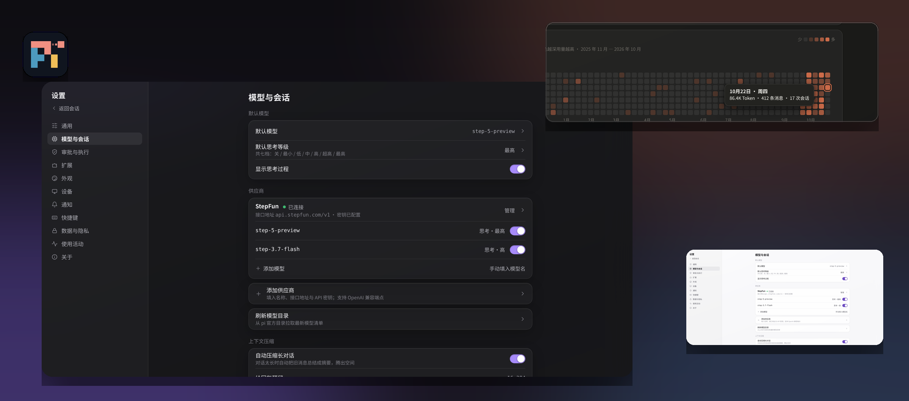
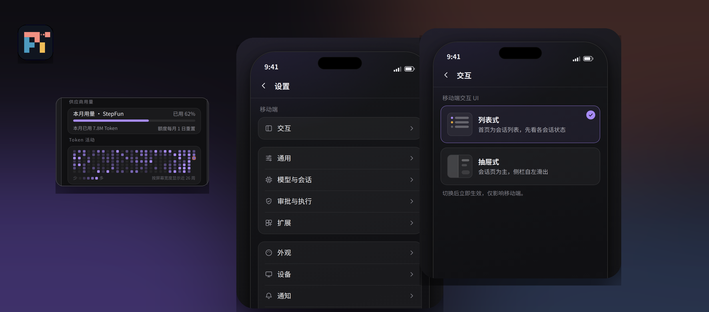

<p align="center">
  
</p>

<h1 align="center">Pi-Remote</h1>

<p align="center">Multi-device sync for the pi terminal: mirror a live session to the browser, view it, send messages, and run commands remotely.</p>

<p align="center">
  <a href="LICENSE"></a>
  <a href="package.json"></a>
</p>

<p align="center">English | <a href="README.zh-CN.md">简体中文</a></p>

Pi-Remote attaches to a running pi session through pi's official extension API. It does not modify pi's source code and does not take over the terminal. The session stays in the local pi process at all times; the browser shows a real-time mirror of that session and can send messages and commands back to it, including switching models, changing the thinking level, compacting context, and navigating the session tree. The local side runs on Windows, macOS, and Linux, and several machines can be connected at the same time.

> **Relationship to pi**: Pi-Remote is a companion tool built for [pi](https://github.com/earendil-works/pi), Earendil's terminal coding agent, on pi's official extension API, for people who use pi. It is not a fork, variant, or replacement of pi: pi itself keeps running in the local terminal, and Pi-Remote only adds a remote mirror and control surface for it.

<p align="center">
  
</p>
<p align="center">
  
</p>
<p align="center"><sub>UI design mockups: desktop above, mobile below.</sub></p>

## Features

- **Live mirroring** — output, tool calls, and status changes in the terminal sync to the browser in real time, with incremental catch-up after a reconnect.
- **Remote input** — send messages to the session from the browser. While pi is busy, messages can queue or steer, and delivery is confirmed.
- **Remote commands** — switch model and thinking level, compact manually, create / fork / clone sessions, navigate the session tree, and inspect usage. Commands execute in the local pi process.
- **Multiple devices** — several machines can share one relay. The UI lists each device, its online state, and its sessions, and can start a new session on a chosen device.
- **Desktop and mobile UI** — separate layouts for desktop and mobile, with six skins: Cursor, Claude, and Codex looks in dark and light.
- **Usage visibility** — token and cost usage updates with the session and is shown in the UI status area.
- **Connection gating** — a device is reachable only while its attach window is running. Closing the window disconnects it immediately.

## How it works

```
local pi (extension) ──7001──▶ relay (server) ──7002──▶ browser
```

| Component | Location | Role |
|---|---|---|
| Sync extension | `extension/pi-remote-sync.ts` | Runs inside the pi process. Forwards session events, receives remote messages and commands and executes them locally, reconnects after drops |
| Relay | `relay/` | Node service running on a server. Handles authentication, forwarding, and the device/session index. Holds no model credentials and no local files |
| Web UI | `ui/` | Served by the relay. Renders the session stream, sends messages and commands, manages devices and sessions |

The full protocol definition is in [readyUI/data-interface.md](readyUI/data-interface.md).

## Quick start

Requirements: Node ≥ 22.18, and pi installed globally.

The following runs the full loop on one machine, no server involved:

Windows:

```powershell
npm install
npm run relay          # 127.0.0.1:7001 (extension channel) and 7002 (web UI)
deploy\start-pi.cmd    # in a second terminal: start pi
```

macOS / Linux:

```bash
npm install
npm run relay
node deploy/setup.cjs ws://127.0.0.1:7001
deploy/sync-extension.sh   # install the extension into ~/.pi/agent/extensions/
deploy/attach.sh           # open the attach window; the device comes online
deploy/start-pi.sh         # in a second terminal: start pi
```

Open `http://127.0.0.1:7002` and enter the viewer token from your `.env`.

For running the relay on a server (systemd setup, token management, troubleshooting), see [deploy/README.md](deploy/README.md).

## Security model

- The extension and the web UI use separate tokens: a local token for the extension-to-relay channel and a viewer token for web login. Both configuration files are gitignored.
- The extension channel (7001) binds to 127.0.0.1 by default. The web channel (7002) serves the page and WebSocket only; it exposes no file endpoints.
- Anyone holding the viewer token can send messages to a session, and pi runs with tool permissions. Treat the token as a password. For access over the public internet, use a private network, a tunnel, or a TLS reverse proxy instead of exposing port 7002 directly.
- Remote bash is disabled by default and must be enabled explicitly on the local machine; its working directory is restricted to session directories and registered projects.
- Conversation content is not persisted by default. Persistence is opt-in, with a 30-day retention.

## Known limitations

- Long transcripts are not virtualized. The UI mounts the most recent 300 messages and loads older ones page by page.
- The relay needs a server you manage (the local loop mode excepted).
- Pi-Remote is designed for personal, single-user use. There is no multi-user permission system.

## Documentation

- Deployment and troubleshooting: [deploy/README.md](deploy/README.md)
- UI development: [ui/README.md](ui/README.md)
- Sync protocol and command definitions: [readyUI/data-interface.md](readyUI/data-interface.md)
- Terminal vs. remote capability inventory: [readyUI/pi-interface-inventory.md](readyUI/pi-interface-inventory.md)

## Development

```bash
npm install
npm --prefix ui install
npm test              # unit and protocol tests; needs neither pi nor a model
cd ui && npx tsc -b && npm run build
```

Make sure tests pass before submitting, and that the change contains no `.env` files, tokens, private keys, or real session content.

## Authors

- **Muse** (Meta)
- **DeepSeek**

## Star History

[](https://star-history.com/#Xpropel/pi-remote&Date)

## License

[MIT](LICENSE)
