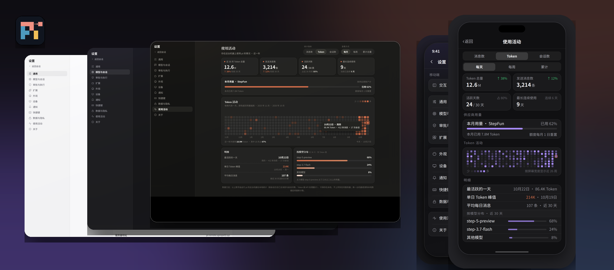

<p align="center">
  
</p>

<h1 align="center">Pi-Remote</h1>

<p align="center">pi 的多端同步工具：将会话从本机终端实时镜像到浏览器，远程查看、发消息、执行命令。</p>

<p align="center">
  <a href="LICENSE"></a>
  <a href="package.json"></a>
</p>

<p align="center"><a href="README.md">English</a> | 简体中文</p>

Pi-Remote 通过 pi 官方扩展 API 接入正在运行的 pi 会话，不修改 pi 源码，不接管终端。会话始终由本机的 pi 进程持有；浏览器端看到的是同一会话的实时镜像，并可向该会话发送消息与命令，包括切换模型、调整思考级别、压缩上下文、管理会话树等。本机端支持 Windows、macOS 与 Linux，多台设备可同时接入。

> **与 pi 的关系**：Pi-Remote 是为 [pi](https://github.com/earendil-works/pi)（Earendil 的终端编码智能体）开发的配套工具，基于 pi 官方扩展 API 构建，服务对象是 pi 的使用者。它不是 pi 的分支、变体或替代品：pi 本体始终在本机终端中运行，Pi-Remote 只为它增加远程镜像与操作入口。

<p align="center">
  
</p>
<p align="center"><sub>界面设计稿：左为桌面端，右为移动端。</sub></p>

## 功能

- **实时镜像**：终端中的输出、工具调用与状态变化实时同步到浏览器，断线重连后按增量补齐。
- **远程输入**：在浏览器中向会话发送消息；pi 忙碌时可选择排队或插队（steer），发送结果有确认回执。
- **远程命令**：切换模型与思考级别、手动压缩、新建 / 分叉 / 克隆会话、会话树导航、查看用量等命令由本机 pi 执行后返回结果。
- **多设备**：多台电脑可同时接入同一 relay，界面按设备展示在线状态与各自的会话列表，并可远程拉起某台设备上的新会话。
- **双端界面**：桌面与移动两种布局；Cursor、Claude、Codex 三种风格各含深、浅两套皮肤，共六套。
- **用量可见**：Token 与费用用量随会话实时更新，显示在界面状态区。
- **连接门控**：设备仅在 attach 窗口运行期间上线，窗口关闭即断开，远程无法再触达本机。

## 工作原理

```
本机 pi（扩展） ──7001──▶ relay（服务器） ──7002──▶ 浏览器
```

| 组件 | 位置 | 说明 |
|---|---|---|
| 同步扩展 | `extension/pi-remote-sync.ts` | 运行于 pi 进程内。订阅会话事件并转发，接收远程消息与命令并在本机执行，断线后自动重连 |
| relay | `relay/` | Node 服务，部署在服务器上。负责鉴权、转发、设备与会话索引。不持有模型凭据，不接触本机文件 |
| 网页界面 | `ui/` | 由 relay 静态托管。订阅会话流并渲染，发送消息与命令，管理设备与会话 |

协议帧的完整定义见 [readyUI/data-interface.md](readyUI/data-interface.md)。

## 快速开始

环境要求：Node ≥ 22.18，本机已全局安装 pi。

以下为本机闭环（不依赖服务器）：

Windows：

```powershell
npm install
npm run relay          # 127.0.0.1:7001（扩展通道）与 7002（网页）
deploy\start-pi.cmd    # 在另一个终端中启动 pi
```

macOS / Linux：

```bash
npm install
npm run relay
node deploy/setup.cjs ws://127.0.0.1:7001
deploy/sync-extension.sh   # 将扩展安装到 ~/.pi/agent/extensions/
deploy/attach.sh           # 开启 attach 窗口，设备上线
deploy/start-pi.sh         # 在另一个终端中启动 pi
```

浏览器打开 `http://127.0.0.1:7002`，输入 `.env` 中的 viewer token 即可进入。

将 relay 部署到服务器长期运行（含 systemd 配置、token 管理与故障排查）见 [deploy/README.md](deploy/README.md)。

## 安全模型

- 扩展与网页使用两枚独立 token：local token 用于扩展连接 relay，viewer token 用于网页登录。相关配置文件均已加入 `.gitignore`。
- 扩展通道（7001）默认仅绑定 127.0.0.1；网页通道（7002）仅提供页面与 WebSocket，不提供文件接口。
- 持有 viewer token 的人可以向会话发送消息，而 pi 具备工具执行权限，因此该 token 应按密码保管。跨公网使用时应通过内网、隧道或 TLS 反向代理访问，不要直接暴露 7002 端口。
- 远程 bash 默认关闭，需在本机显式开启，且工作目录限制在会话目录与已登记项目内。
- 对话正文默认不落盘；仅在显式开启持久化时写入，保留期 30 天。

## 已知限制

- 长会话未做虚拟化渲染：界面一次挂载最近 300 条消息，更早内容按页加载。
- relay 需要一台自行管理的服务器（本机闭环模式除外）。
- 当前面向个人单用户场景设计，不提供多用户权限体系。

## 文档

- 部署与排障：[deploy/README.md](deploy/README.md)
- 界面开发：[ui/README.md](ui/README.md)
- 同步协议与命令定义：[readyUI/data-interface.md](readyUI/data-interface.md)
- 终端与远端能力对照：[readyUI/pi-interface-inventory.md](readyUI/pi-interface-inventory.md)

## 开发

```bash
npm install
npm --prefix ui install
npm test              # 单元与协议测试，不需要 pi 与模型
cd ui && npx tsc -b && npm run build
```

提交代码前请确保测试通过，且不包含 `.env`、token、私钥或真实会话内容。

## 贡献

| 分工 | 担当 |
| --- | --- |
| 创始人 | Xpropel |
| UI 设计 | Muse（Meta） |
| 代码执行 | DeepSeek |
| 项目规划 | Claude、ChatGPT |

## Star 趋势

[](https://star-history.com/#Xpropel/pi-remote&Date)

## 许可证

[MIT](LICENSE)
