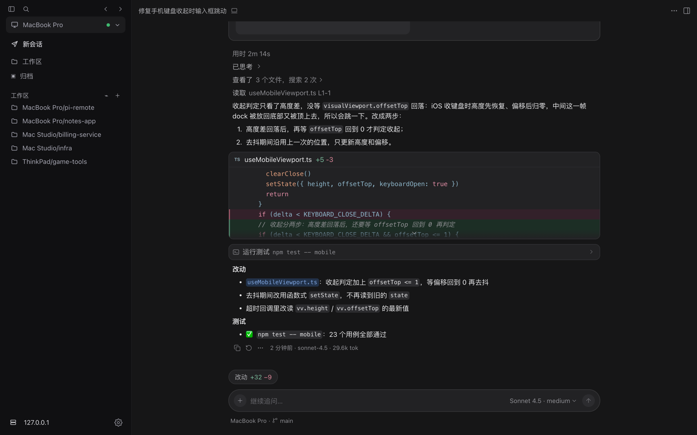

[English](README.md) | 简体中文

# pi-remote

把电脑上正在跑的 pi 会话，搬到手机浏览器里接着用。

[](LICENSE)
[](package.json)

我平时在终端里用 [pi](https://github.com/earendil-works/pi) 写代码，会话动不动跑很久，人却不想一直钉在电脑前。想换个地方、或者就出门买杯咖啡的时候，能拿手机看一眼进度、顺手回一句，比什么都强。pi-remote 就是为这个做的：终端里的会话照常跑，手机上打开网页，看到的是同一个会话，能看，也能发消息、发命令。

它没有改 pi 的源码，也没有劫持终端输出，走的是 pi 官方的扩展 API（事件订阅 + `sendUserMessage` 注入）。pi 升级不会把这个项目带沟里，我也不用跟着维护一个分叉版本。

<p align="center">
  
</p>
<p align="center"><sub>截图来自内置开发画廊的演示数据，不是真实会话。</sub></p>

## 大概是怎么工作的

```
电脑上的 pi ──扩展──▶ relay（小服务器）──▶ 手机 / 其他电脑的浏览器
```

三部分：

- **扩展**（`extension/pi-remote-sync.ts`）跑在 pi 进程里，把会话事件发出去，再把远程发来的消息和命令送进来。切模型、改思考级别、压缩、开新会话这些操作，远程发命令、本机执行。
- **relay**（`relay/`）是个 Node 服务，负责转发和暂存索引。它不装 pi，也没有你的模型密钥，只过 JSON。
- **网页**（`ui/`）就是浏览器里打开的那个界面。桌面和手机是两种布局，皮肤有 Cursor / Claude / Codex 三种风格的深浅色，一共六套，看腻了能换。

多台电脑可以同时连同一个 relay，手机上能看到哪台在线、各自有哪些会话。

## 先在本机跑通

不需要服务器，同一台电脑上就能闭环试一遍。需要 Node ≥ 22.18 和全局安装的 pi。

Windows：

```powershell
npm install
npm run relay          # 监听 127.0.0.1:7001（扩展通道）和 7002（网页）
deploy\start-pi.cmd    # 另一个终端窗口里，用它启动 pi
```

macOS / Linux：

```bash
npm install
npm run relay
node deploy/setup.cjs ws://127.0.0.1:7001
deploy/sync-extension.sh   # 把扩展装进 ~/.pi/agent/extensions/
deploy/attach.sh           # 开 attach 窗口，设备上线
deploy/start-pi.sh         # 另一个终端里启动 pi
```

然后浏览器打开 `http://127.0.0.1:7002`，填 `.env` 里配的 viewer token，就能看到终端里那个会话了。

正式用的时候，把 relay 放到一台你自己的小服务器上（systemd 托管），本机先开 attach 窗口再启 pi。服务器部署、换 token、排障的细节都在 [deploy/README.md](deploy/README.md) 里，写得比这里细。

**attach 窗口是个物理开关**：窗口开着，设备才连得上；窗口一关，扩展立刻断开，远程什么都碰不到你的电脑。我很喜欢这个设计，简单，心里有数。

## 安全上，有几件事得说清楚

- 有两个 token：扩展连 relay 用一个，网页登录用一个（viewer token）。配置文件都已经 gitignore，别手滑提交。
- **viewer token 泄露不是小事**。拿到它的人能给你的 pi 发消息，而 pi 是带工具权限的，约等于能远程操作你的电脑。所以别把 7002 端口裸着放公网：要么走内网/隧道，要么前面套一层 HTTPS 反代。
- relay 默认只把扩展通道绑在本机地址上；远程执行 bash 默认是关的，要在本机显式打开才行。
- 对话正文默认不落盘，只是转发；开了持久化开关才会存，并且 30 天自动清。

## 现在的状态和毛病

这是我自己天天在用的东西，不是 demo。但它也是按我一个人的用法打磨的，有些地方还糙：

- 长会话没有做真正的虚拟滚动，一次先挂最近 300 条，更早的点一下再往前翻一页。日常够用，超长会话翻起来有点累。
- 只在 Windows 和 macOS 上认真跑过，Linux 本机端支持 tmux 拉起，但我用得少，坑可能比我知道的多。
- 界面迭代比较快，文档偶尔跟不上代码，发现对不上的地方请直接开 issue 骂我……我是说，告诉我。

仓库里有完整的测试（`npm test`，不需要 pi 和模型就能跑），改代码前请先跑一遍。

## 想细看

- 部署和排障：[deploy/README.md](deploy/README.md)
- 界面开发：[ui/README.md](ui/README.md)
- 同步协议和命令的精确形状：[readyUI/data-interface.md](readyUI/data-interface.md)

## 参与开发

欢迎 PR。提交前跑 `npm test`，前端改动再过一遍 `cd ui && npx tsc -b && npm run build`。别提交 `.env`、token 和真实会话内容。安全问题别发公开 issue，走仓库的私密报告渠道。

## 许可证

MIT，见 [LICENSE](LICENSE)。
